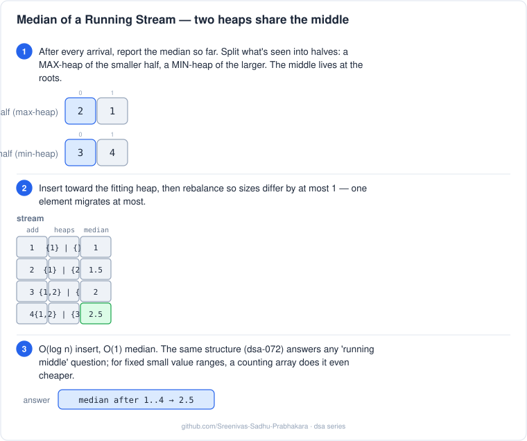

# Median in a Running Stream (Sorted Insert)

> Striver SDE Sheet 147 · Day 22 Mixed — keep the stream sorted with binary-searched insertions; the median is an index away. Contrast piece to the two-heap version. Go, stdlib only, tested.

## Problem

Maintain the median as numbers arrive one by one. The sheet repeats this problem from Day 12 (#072) on purpose — same spec, different structure — so the two solutions can be weighed against each other.

## Approach

Keep all values in one sorted slice: `sort.SearchInts` finds the insertion point in O(log n), the `copy` shift pays O(n), and Median reads one or two middle indexes directly. Versus the two heaps (#072): asymptotically worse on insert (O(n) vs O(log n)), but with contiguous memory, zero allocations per op beyond the append, and trivial code — for streams up to tens of thousands of values the memmove routinely beats heap pointer-chasing in practice. Knowing *when* the asymptotically-worse tool wins is the lesson; the tests cover duplicates and adversarial descending inserts.

**Complexity:** Add O(n) worst case (memmove), Median O(1).

## Visual walkthrough

Read the picture top to bottom — each numbered frame is one moment of the algorithm
running on this repo's test example.

## Run

    go test ./...   # verify
    go run .        # demo

---

One of 191 repos solving Striver's SDE Sheet in Go — stdlib only, one problem per repo, every solution tested. Browse the set: [`dsa-*` repos](https://github.com/Sreenivas-Sadhu-Prabhakara?tab=repositories&q=dsa-&type=source).
